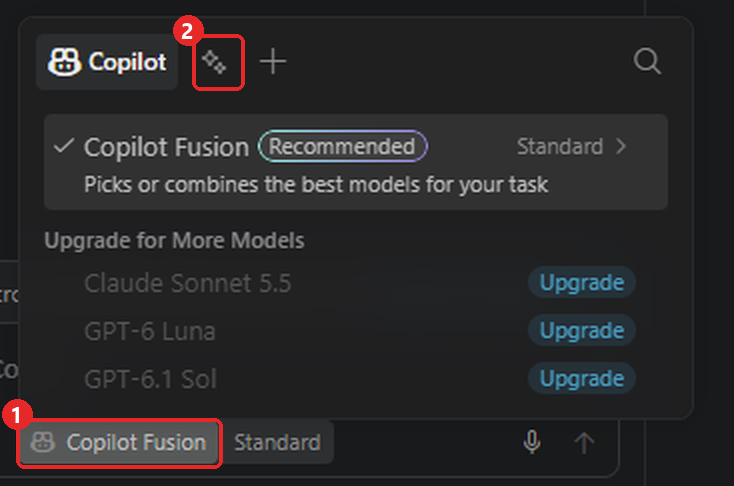
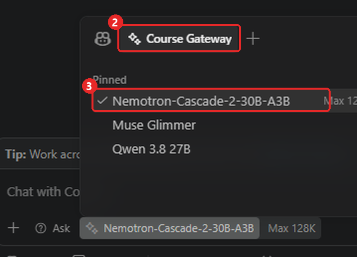
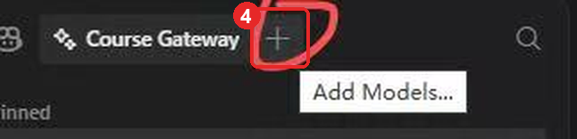
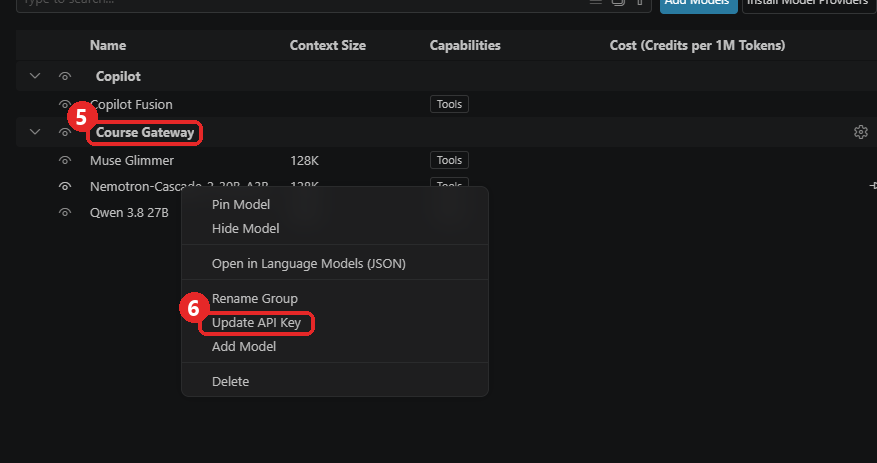
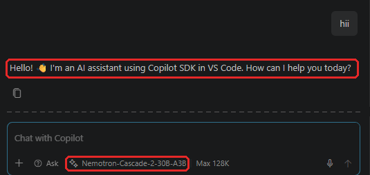

# Your course AI coding assistant

A free AI coding assistant, running on your university's own hardware. **Nothing to
install** — no extension, no GitHub account, no Copilot subscription, no cost.

There are only two values you ever need:

| | |
|---|---|
| **Base URL** | `https://gateway.cis261803.projects.jetstream-cloud.org/v1` |
| **API key** | the `sk-...` your instructor sent you — yours alone |

The URL is the same for the whole class. Only the key is yours.

**Models:** `Nemotron-Cascade-2-30B-A3B` (start with this one) · `qwen-3.8-27b` ·
`muse-glimmer`

**Hours:** `Nemotron-Cascade-2-30B-A3B` runs **every day, 8:00 AM – 1:00 AM US Eastern**
(it is ready about 10 minutes after 8:00). Outside those hours it answers with a short
"offline" message instead. `qwen-3.8-27b` and `muse-glimmer` work at any time, but they are
shared by everyone on Jetstream2, so they can be slow or busy.

---

## VS Code

The course uses VS Code. You need **VS Code 1.122 or newer** — check with
**Help → About**.

### Step 1: one command

```bash
python student_setup.py --key <YOUR-KEY>
```

It checks your key works, backs up your current settings, and writes the configuration.
The address is already in the script. Safe to re-run.

### Step 2: pick the model and add your key

The script cannot hand your key to VS Code, so you add it yourself. Do it again every time
you re-run the script or get a new key.

1. Reload the window: `Ctrl+Shift+P` → **Developer: Reload Window** (`Cmd+Shift+P` on Mac).

2. Open the **Chat** view: `Ctrl+Alt+I` (`Ctrl+Cmd+I` on Mac).

3. Open the **model menu**: click the model name at the bottom of the chat box ①. At first
   it says **Copilot Fusion**. Shortcut: click in the chat box, then press `Ctrl+Alt+.`
   (`Cmd+Option+.` on Mac).

4. Then click the **Course Gateway** icon, to the right of **Copilot** ②. The menu now
   lists the course models.

   

5. Pick **Nemotron-Cascade-2-30B-A3B** ③.

   

6. Click the **+** next to **Course Gateway** ④. Its tooltip says *Add Models...*.

   

7. In the list that opens, find the **Course Gateway** group ⑤. Right-click one of its
   models, choose **Update API Key** ⑥, paste your key, and press Enter.

   

8. Test it. Type a short message such as `hi` in the chat box and send it. If a reply comes
   back from **Nemotron-Cascade-2-30B-A3B**, everything is set up. The reply may say it is
   Copilot; that is normal, because VS Code tells it to say so, and your message still goes
   to the course server.

   

   If you get an error instead, find it in **When it does not work** below.

---

## When it does not work

| What you see | What it means |
|---|---|
| `401`, "invalid API key" | The key is wrong, or has a space or line break in it. Copy it again, and set it with **Update API Key** (Step 2 above). |
| `403` | **Almost always the model name.** Your key is fine — it just does not cover the name you sent. A *misspelling* gives exactly the same 403 as a model you are not allowed, so check spelling first: `Nemotron-Cascade-2-30B-A3B`, case-sensitive. |
| Connection refused, timeout | A network that blocks the gateway. Run `python student_setup.py --key <YOUR-KEY> --dry-run`: it checks your key and the connection, and changes nothing. |
| "The course AI model (Nemotron) is offline right now" | Nemotron is switched off outside 8:00 AM – 1:00 AM US Eastern. Come back then, or pick `qwen-3.8-27b` meanwhile. If you see it inside those hours, tell your instructor. |
| `429` | You are sending too fast. Wait a minute. |
| Empty reply, "no response was returned" | A model problem, not yours. Switch to another of the three. |
| "Custom Endpoint" missing | VS Code older than 1.122. Help → About. |
| Model shows in Chat but not in Agent mode | `toolCalling` is missing or `false` for it in the config. Re-run `student_setup.py`. |

**Never paste your API key into a public AI assistant, a forum, or a screenshot.** It
identifies you, and everything it does is logged under your name.

Still stuck: send the course staff what you did and the **exact error text**. "It does not work" cannot be diagnosed; `401` can.

---

## Two things to know

**Your conversations are recorded.** Everything you type and everything the model replies is
saved on the course server, where course staff can read it. Do not type anything there you
would not want them to see.

**Check the course policy on AI use.** This being available does not mean it is allowed on
every assignment. Ask before you use it if you are unsure.
